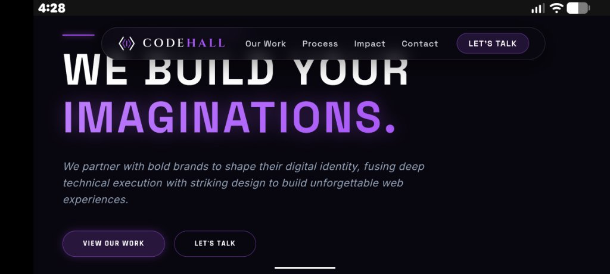
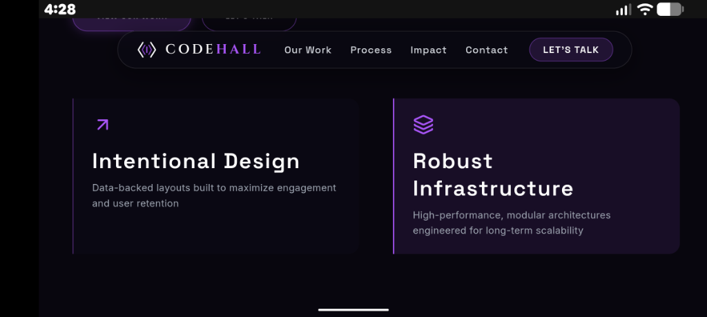
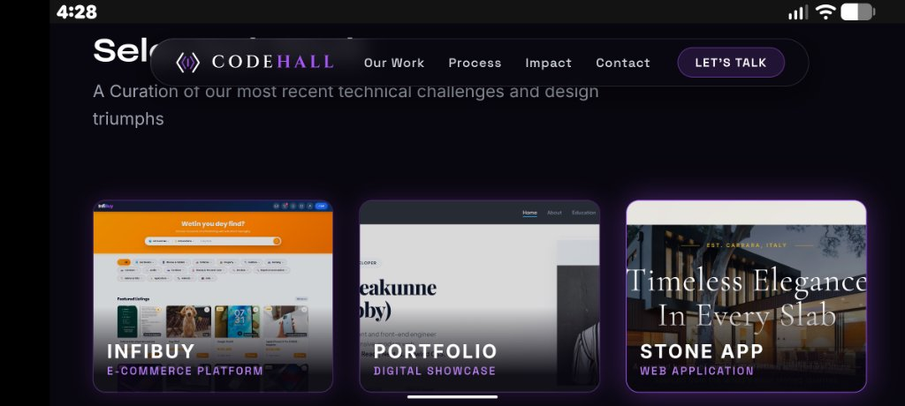
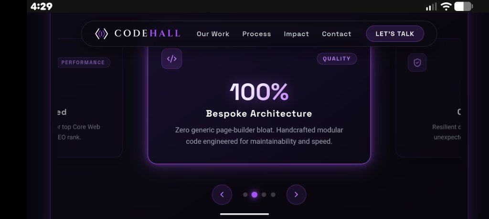
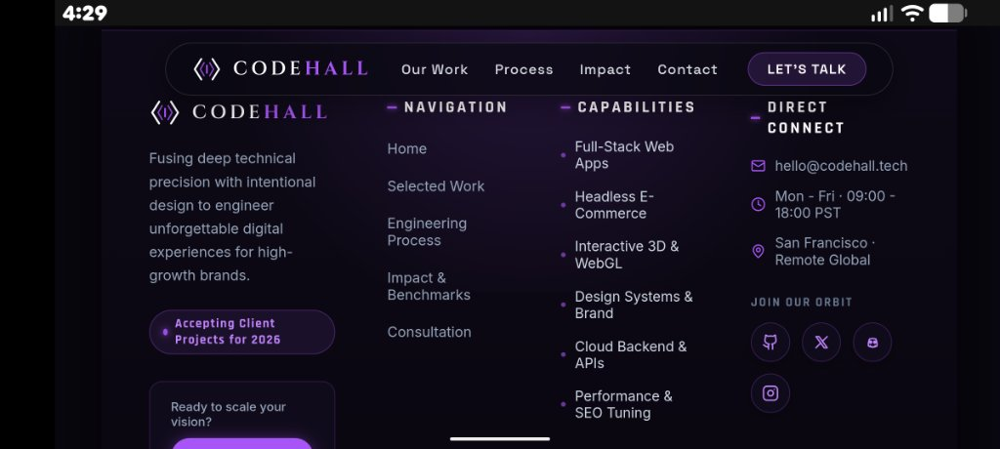

# CodeHall - Agency Landing Page

A responsive, single-page landing page built for **Level 1 (Task 1)** of the **Oasis Infobyte (OIBSIP)** Web Development internship.

The goal of this task was to build a clean static landing page with foundational layout skills for CodeHall Coding Agency: a fixed navigation bar, hero section with call-to-action buttons, distinct content blocks, clean typography, and a working footer with social/contact links.

I based the design on a dark-mode agency concept called **CodeHall**, styled using a custom purple and black color palette (`#a855f7` on `#08060e`). Everything lives on a single page, and all navigation links smoothly scroll to their respective sections.

---

## Screenshots

Here are screenshots of the landing page in action:

### 1. Hero Section & Fixed Navigation

The top of the page features a fixed floating navigation bar with the CodeHall logo, navigation links, and a contact button. The hero has a clear headline ("WE BUILD YOUR IMAGINATIONS.") that uses fluid font scaling (`clamp()`) so it wraps properly on mobile screens without overflowing or creating horizontal scrollbars.

### 2. Agency Pillars

Two core service cards ("Intentional Design" and "Robust Infrastructure") arranged in a 2-column layout that shifts into a single column on mobile.

### 3. Selected Work Showcase

A gallery highlighting three projects directly on the page:
- **Infibuy:** An e-commerce platform
- **Portfolio:** A developer showcase
- **Stone App:** A web application for inventory management

Each card includes preview images, category badges, and hover effects.

### 4. Impact & Performance Metrics

An interactive carousel highlighting key stats (like `<0.8s` load times, `100%` bespoke code, and `99.9%` uptime) with next/previous buttons and indicator dots.

### 5. Footer & Navigation

A structured footer with:
- The agency brand mark and project availability status
- Navigation buttons that smoothly scroll to sections on the homepage (`#home`, `#work`, `#process`, `#impact`, `#contact`)
- A capabilities list
- Direct contact details (email, hours, location)
- Social profile links (GitHub, Twitter/X, Discord, Instagram)
- A "Back to Top" button

---

## Features & Requirements Checklist

This project fulfills all criteria set out for Level 1:

- [x] **Fixed/Sticky Navbar:** Glassmorphic bar that stays fixed at the top with a mobile toggle menu.
- [x] **Hero Section:** Clear headline, subheadline, and primary/secondary CTA buttons.
- [x] **Distinct Content Sections:**
  - Agency Pillars
  - Selected Work
  - Feature Process Slider
  - Impact Metrics Carousel
  - Contact / Consultation Card
- [x] **Structured Footer:** Multi-column layout with working navigation anchors, contact details, social links, and back-to-top button.
- [x] **Consistent Color Scheme:** Obsidian dark background with Electric Violet accents (`#a855f7` and `#c084fc`).
- [x] **Responsive Layout:** Built using pure CSS Grid and Flexbox. Tested across mobile (320px–390px), tablet, and desktop (1440px) viewports with zero horizontal overflow.
- [x] **Clean Spacing & Typography:** Box-sizing is set to `border-box` across all elements, with fluid typography scales using `Space Grotesk`, `Syne`, and `Inter`.
- [x] **Single-Page Design:** All navigation links jump or smoothly scroll to sections on the same page. There are no external routing dependencies or missing subpages.

---

## Tech Stack

- **Framework:** React 19
- **Build Tool:** Vite
- **Styling:** Vanilla CSS3 (CSS Grid, Flexbox, custom CSS variables, `clamp()` fluid math)
- **Icons:** Lucide React & inline SVGs

---

## Project Structure

```
WEBDEV-L1-LANDINGPAGE/
├── screenshots/                 # Screenshots used in this README
│   ├── 01-hero-section.png
│   ├── 02-agency-pillars.png
│   ├── 03-selected-work.png
│   ├── 04-impact-metrics.png
│   └── 05-professional-footer.png
├── public/
│   ├── favicon.svg
│   └── icons.svg
├── src/
│   ├── assets/                  # Project images and portraits
│   ├── components/
│   │   ├── AutoFeatureSlider.jsx # Feature slider component
│   │   ├── CodeHallLogo.jsx      # Vector logo mark
│   │   ├── ContactSection.jsx    # Consultation and contact section
│   │   ├── Footer.jsx            # Multi-column footer component
│   │   ├── InfoSlider.jsx        # Impact metrics carousel
│   │   ├── Navbar.jsx            # Fixed floating navbar & mobile menu
│   │   └── ScrollToTop.jsx       # Scroll position reset helper
│   ├── pages/
│   │   ├── Home.jsx              # Main landing page
│   │   └── Home.css              # Main landing page styles
│   ├── App.jsx                  # Root component (renders Home)
│   ├── App.css                  # Global background & scrollbar styles
│   ├── index.css                # Color variables & reset rules
│   └── main.jsx                 # Entry point
├── index.html                   # HTML document
├── package.json
└── vite.config.js
```

---

## Getting Started Locally

### Prerequisites
Make sure you have [Node.js](https://nodejs.org/) installed (v18 or newer).

### Installation & Development

```bash
# 1. Install dependencies
npm install

# 2. Run the development server
npm run dev
```

Visit `http://localhost:5173` in your browser.

### Production Build

```bash
# Build production bundle in dist/
npm run build

# Preview the production build locally
npm run preview
```

---

## License

Created for educational purposes as part of the Oasis Infobyte Web Development Internship (OIBSIP).
